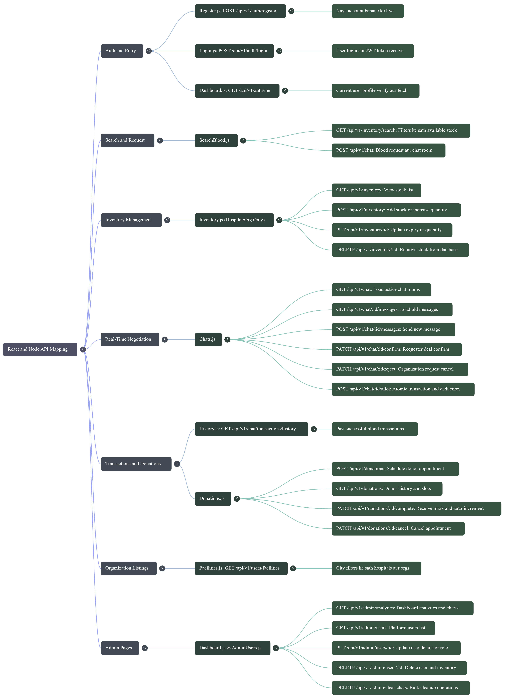

# 🩸 BloodLink - Real-Time Blood Bank Management System

<p align="center">
  
  
  
  
  
  
  
</p>

<p align="center">
  <strong>A full-stack MERN application with real-time Socket.io integration, designed to bridge the gap between Blood Donors, Hospitals, Organizations, and Customers seamlessly.</strong>
</p>

---

## 🚀 Live Demo & Deployments

- **Frontend (Vercel):** [BloodLink Live Demo](https://bloodlink-mern-phi.vercel.app)
- **Backend API (Railway):**

---

## ✨ Key Features & Core Business Logic

- 🔐 **Role-Based Access Control (RBAC):** Distinct interfaces and operational logic for `Admin`, `Customer`, `Donor`, `Hospital`, and `Organization`.
- 💬 **Real-Time Negotiation Engine:** Integrated **Socket.io** enables live chat between blood Requesters and Organizations to negotiate quantities before approval.
- ⚛️ **Atomic Inventory Transactions:** When blood is allotted, the system executes an atomic transaction, simultaneously deducting the Organization's stock, logging transaction history, and updating the Hospital's receiving inventory.
- 🩸 **Smart Global Search:** Enables users to find specific blood groups across all registered facilities, filtered by city and availability.
- 📅 **Donation Scheduling Flow:** Donors can book appointments. Facilities mark them as "Completed" to automatically increase their active blood bank stock.
- 📈 **Admin Analytics Dashboard:** Centralized view of total platform users, live blood stock volumes, and dynamic transaction metrics.

---

## 🛠️ Comprehensive Tech Stack

### 🖥️ Client-Side (Frontend)

| Technology | Description |
| :--- | :--- |
| **React.js & React Router v6** | UI library for SPA and dynamic nested routing |
| **Tailwind CSS** | Utility-first CSS framework for responsive layouts |
| **Material UI (MUI)** | React component library for avatars, badges, and icons |
| **Axios** | Promise-based HTTP client for API requests |
| **Socket.io-Client** | Client-side library for real-time communication |

### ⚙️ Server-Side (Backend)

| Technology | Description |
| :--- | :--- |
| **Node.js & Express.js** | Backend runtime and web framework |
| **MongoDB & Mongoose** | NoSQL database and Object Data Modeling (ODM) |
| **Socket.io** | Real-time bidirectional event communication |
| **JWT** | JSON Web Tokens for authentication |
| **Bcrypt.js** | Password hashing and security |

---

## 📂 Project Structure

```text
blood-management/
│
├── backend/
│   ├── middleware/
│   │   └── auth.js              # JWT verification & RBAC protection
│   │
│   ├── models/                  # Mongoose Schemas
│   │
│   ├── routes/                  # Express API Routes
│   │
│   ├── .env                     # Backend environment variables
│   ├── server.js                # Main Express server entry point
│   └── socket.js                # Socket.io configuration
│
├── frontend/
│   ├── public/
│   │   └── index.html           # Main HTML template
│   │
│   ├── src/
│   │   ├── components/          # Reusable UI components
│   │   ├── context/             # Global State Management
│   │   ├── pages/               # Application Views
│   │   ├── api.js               # Centralized Axios configuration
│   │   ├── App.js               # React Router DOM setup
│   │   ├── index.css            # Global Tailwind styling
│   │   └── index.js             # React DOM rendering
│   │
│   └── .env                     # Frontend environment variables
│
├── docs/
│   └── api-architecture.png     # API Architecture Flowchart
│
├── .gitignore
└── README.md
```

---

## 📊 Database Architecture & API Flow

### 1. Entity Relationship Diagram (ER Diagram)

The database architecture represents the relationships between different entities of the BloodLink system, including users, organizations, hospitals, blood inventory, donations, chats, and transactions.

**Interactive Database ER Diagram:**

🔗 [View BloodLink Database ER Diagram on dbdiagram.io](https://dbdiagram.io/e/6aead7977ded3580fa9c758f/6aeb21607ded3580faa3607b)

### 2. API Architecture & React-Node Mapping

The following flowchart illustrates the mapping between React frontend pages, JavaScript components, and their corresponding Node.js/Express API endpoints.



*The API architecture covers authentication, inventory management, blood search, real-time negotiation, transactions, donations, organization listings, and admin operations.*

---

## 🔄 Core Application Workflow

1. **User Registration:** Users register based on their roles, such as Donor, Customer, Hospital, or Organization.
2. **Authentication:** Users log in and receive a JWT token for secure access.
3. **Blood Search:** Customers and hospitals search for available blood groups across registered facilities.
4. **Blood Request:** Requesters initiate blood requests through the platform.
5. **Real-Time Negotiation:** Requesters and organizations communicate using Socket.io.
6. **Blood Allotment:** Organizations approve requests and allocate available blood units.
7. **Inventory Update:** The system updates stock and records transaction history.
8. **Donation Scheduling:** Donors schedule appointments, and completed donations increase available inventory.
9. **Admin Monitoring:** Admins monitor users, blood stock, transactions, and platform analytics.

---

## 💻 Installation & Local Setup

### 1. Prerequisites

Make sure you have installed:

- Node.js (v16 or above)
- npm
- MongoDB Atlas account or local MongoDB
- Git
- Code Editor (VS Code recommended)

### 2. Clone the Repository

```bash
git clone <YOUR-GITHUB-REPOSITORY-URL>
```

Navigate to the project directory:

```bash
cd blood-management
```

### 3. Configure Environment Variables

Create `.env` files in both the `backend` and `frontend` directories.

**Backend `.env`**

```env
PORT=8080
MONGO_URI=mongodb+srv://<username>:<password>@cluster.mongodb.net/bloodlink
JWT_SECRET=your_super_secret_key_here
CLIENT_URL=http://localhost:3000
```

**Frontend `.env`**

```env
REACT_APP_API_URL=http://localhost:8080/api/v1
```

**Important:** Replace the placeholder values with your actual configuration.

### 4. Install Backend Dependencies

Open a terminal:

```bash
cd backend
npm install
```

Start the backend server:

```bash
npm start
```

Backend server:

```text
http://localhost:8080
```

### 5. Install Frontend Dependencies

Open another terminal:

```bash
cd frontend
npm install
```

Start the frontend application:

```bash
npm start
```

Frontend application:

```text
http://localhost:3000
```

---

## 📞 Core API Endpoints Reference

### Authentication APIs

| HTTP Method | Endpoint | Description | Access |
| :--- | :--- | :--- | :--- |
| POST | `/api/v1/auth/register` | Register a new platform entity | Public |
| POST | `/api/v1/auth/login` | Authenticate and retrieve JWT token | Public |
| GET | `/api/v1/auth/me` | Fetch current user profile | Authenticated |

### Inventory & Search APIs

| HTTP Method | Endpoint | Description | Access |
| :--- | :--- | :--- | :--- |
| GET | `/api/v1/inventory/search` | Search available blood stock | Authenticated |
| GET | `/api/v1/inventory` | View inventory stock | Hospital / Organization |
| POST | `/api/v1/inventory` | Add or increase blood stock | Hospital / Organization |
| PUT | `/api/v1/inventory/:id` | Update expiry or quantity | Hospital / Organization |
| DELETE | `/api/v1/inventory/:id` | Remove inventory stock | Hospital / Organization |

### Chat & Real-Time Negotiation APIs

| HTTP Method | Endpoint | Description | Access |
| :--- | :--- | :--- | :--- |
| GET | `/api/v1/chat` | Load active chat rooms | Authenticated |
| GET | `/api/v1/chat/:id/messages` | Load chat messages | Chat Participants |
| POST | `/api/v1/chat/:id/messages` | Send a new message | Chat Participants |
| PATCH | `/api/v1/chat/:id/confirm` | Requester confirms deal | Authorized |
| PATCH | `/api/v1/chat/:id/reject` | Organization rejects request | Authorized |
| POST | `/api/v1/chat/:id/allot` | Allot blood and execute inventory transaction | Organization |

### Donation APIs

| HTTP Method | Endpoint | Description | Access |
| :--- | :--- | :--- | :--- |
| POST | `/api/v1/donations` | Schedule donor appointment | Donor |
| GET | `/api/v1/donations` | View donor history and slots | Donor |
| PATCH | `/api/v1/donations/:id/complete` | Complete donation and update stock | Authorized Facility |
| PATCH | `/api/v1/donations/:id/cancel` | Cancel donation appointment | Authorized |

### Transaction APIs

| HTTP Method | Endpoint | Description | Access |
| :--- | :--- | :--- | :--- |
| GET | `/api/v1/chat/transactions/history` | View past successful transactions | Authenticated |

### Organization Listing APIs

| HTTP Method | Endpoint | Description | Access |
| :--- | :--- | :--- | :--- |
| GET | `/api/v1/users/facilities` | Fetch hospitals and organizations | Authenticated |

### Admin APIs

| HTTP Method | Endpoint | Description | Access |
| :--- | :--- | :--- | :--- |
| GET | `/api/v1/admin/analytics` | Dashboard analytics and charts | Admin |
| GET | `/api/v1/admin/users` | Fetch all platform users | Admin |
| PUT | `/api/v1/admin/users/:id` | Update user details or role | Admin |
| DELETE | `/api/v1/admin/users/:id` | Delete user and associated inventory | Admin |
| DELETE | `/api/v1/admin/clear-chats` | Bulk chat cleanup operations | Admin |

*Note: Endpoint descriptions and access rules should match the actual backend implementation.*

---

## 🔒 Security Features

- JWT-based user authentication.
- Password hashing using Bcrypt.js.
- Role-Based Access Control (RBAC).
- Protected API routes using authentication middleware.
- Secure environment variable configuration.
- Restricted administrative operations.
- Authorized inventory and transaction management.

---

## 🌟 Future Enhancements

- 📧 Email and SMS notifications for urgent blood requests.
- 📍 Google Maps integration for nearby blood banks.
- 📊 Advanced blood stock analytics and reporting.
- ⏰ Automated blood expiry tracking.
- 📱 Mobile application support.
- 🔔 Real-time notifications for blood requests and donations.

---

## 🎯 Project Objective

The main objective of BloodLink is to create a centralized platform that connects blood donors, hospitals, blood banks, organizations, and customers.

The system aims to simplify blood availability management, improve communication, provide real-time inventory updates, and make the blood donation process more efficient.

---

## 👨‍💻 Contributors

Developed with ❤️ to make blood donation and blood availability management easier, faster, and more accessible.

<p align="center">
  <strong>🩸 BloodLink – Every Drop Counts! 🩸</strong>
</p>

<p align="center">
  If you find this project useful, don't forget to ⭐ the repository!
</p>
